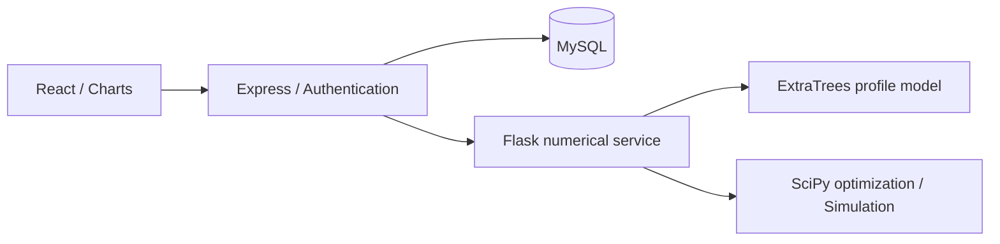

# Rocky Finance — Portfolio Research Application

A full-stack research application combining survey-based risk profiling, constrained portfolio optimization, rolling evaluation and Monte Carlo scenarios.

**[Live application](https://finance.imrocky.com)** · **[Author's portfolio](https://imrocky.com)** · [Data preparation](docs/DATA-SETUP.md)

## Review the project in three minutes

1. Open the [live application](https://finance.imrocky.com/user), create your own account and use fictional household inputs.
2. Estimate the profile proxy, choose **Load Magnificent Seven**, then optimize and inspect the holding cap, equal-weight comparison and rolling historical evaluation.
3. Continue to the simulator and compare baseline, optimistic and pessimistic outcomes using the same portfolio.

The example selects AAPL, MSFT, AMZN, GOOGL, META, NVDA and TSLA. It includes one Alphabet share class and remains editable. Numerical constraints, dated data and model limitations are visible in the application.

For verification without raw research data, install the core/data dependencies and run `python scripts/test-python.py`, plus the JavaScript tests below. This entry uses in-memory unit-test fixtures only; normal application startup still requires real research inputs. GitHub Actions verifies Node 24, Python 3.12, tests, the production build and runtime dependency advisories without production credentials.

Read the [portfolio readiness review](docs/PORTFOLIO-READINESS-2026-10-29.zh-CN.md) for evidence and remaining limitations. The current build uses deprecated Create React App tooling, has known development-tool advisories and a roughly 693 kB gzip main bundle; runtime audit results do not mean a complete security assessment. The deployed market history and provenance are described in the [full CSV update report](docs/FULL-HISTORY-UPDATE-2026-10-29.zh-CN.md).

## Main workflow

1. Complete a financial profile and estimate a survey-based risky-asset-share proxy.
2. Select eligible stocks and construct a portfolio subject to allocation constraints.
3. Inspect the efficient frontier and compare rolling results with an equal-weight baseline.
4. Import the allocation into Historical, GARCH(1,1) or Parametric Monte Carlo scenarios, with cash flows and inflation adjustments.

The profile target is observed risky-asset share in survey data. It is a research proxy, not a validated psychological risk assessment or a prediction of future returns. Published model metrics describe their recorded dataset and split; they are not investment performance claims.

## Architecture



The browser handles forms and visualizations; Express owns authentication and account data; Flask performs inference and numerical calculations. The Python service is internal and should listen on loopback. Optional legacy news/chat integrations are disabled by default and require external modules and service credentials that are not included here.

## Local setup

Requires Node.js 24, Python 3.12 or 3.13, MySQL 8 and local HTTPS certificates.

### 1. Dependencies and data

```sh
python3 -m venv .venv
. .venv/bin/activate
pip install -r requirements-core.txt
npm ci --prefix backend
npm ci --prefix frontend
```

Prepare the mandatory training and market inputs using [DATA-SETUP.md](docs/DATA-SETUP.md), then train locally:

```sh
python backend/python-service/train_risk_model.py
```

The training workbook, large historical market CSV, generated market exports and pickle model are excluded from Git. A fresh clone needs these data preparation steps before starting Flask. Never load an untrusted pickle model.

### 2. Database and environment

Copy `backend/.env.example` to `backend/.env`. Configure a separate local MySQL database, a random `JWT_SECRET`, and a 32-byte `STORE_ENCRYPTION_KEY` encoded as 64 hexadecimal characters. Keep `ENABLE_AI_EXTENSIONS=0` for the core application.

Create your own database and user, then initialize only that database:

```sh
cd backend
npm run db:init
cd ..
```

This initializer creates tables, rather than providing a complete migration system. Never point it at another project's database.

### 3. Local signing keys and HTTPS

Generate a new local signing pair with the included helper. It refuses to overwrite an existing private key:

```sh
node scripts/generate-keys.cjs
```

Using a locally trusted certificate tool such as [mkcert](https://github.com/FiloSottile/mkcert), create development certificates at `backend/ssl/key.pem` and `backend/ssl/cert.pem`, then copy your local certificate and key to `frontend/ssl/`. The development frontend script expects those paths. Certificates and private keys are local runtime files and must stay out of Git.

### 4. Start the services

Run each in a separate terminal from the repository root:

```sh
.venv/bin/python backend/python-service/app.py
```

```sh
npm start --prefix backend
```

```sh
npm start --prefix frontend
```

Open `https://localhost:3000`. Express listens on local port 5001 and Flask on 5002. The Python `/health` endpoint reports model readiness; the application also requires valid market data before Python startup.

## Verification

```sh
npm test --prefix backend
.venv/bin/python scripts/test-python.py
CI=true npm test --prefix frontend -- --watchAll=false --runInBand
npm run build --prefix frontend
```

Core tests use substitute data or services where documented. Running commands successfully does not validate external AI integrations or live payment/financial services. Publication checks are recorded separately from earlier development and model-evaluation reports.

## Included and excluded

The repository includes application source, dependency lockfiles, numerical and security tests, training code, architecture notes and safe environment templates. It starts with a clean publication history. Credentials, certificate/key files, databases, personal reports, notebooks with outputs, large datasets, generated models, runtime news caches and production infrastructure are excluded.

- [2026-10-28 模型审查、三情景修复与数据边界](docs/MODEL-AUDIT-2026-10-28.zh-CN.md)

- [2026-10-29 线上登录接口地址修复与浏览器验收](docs/LOGIN-ROUTING-FIX-2026-10-29.zh-CN.md)

- [2026-10-29 完整历史 CSV、免费来源、质量记录及每周更新](docs/FULL-HISTORY-UPDATE-2026-10-29.zh-CN.md)
